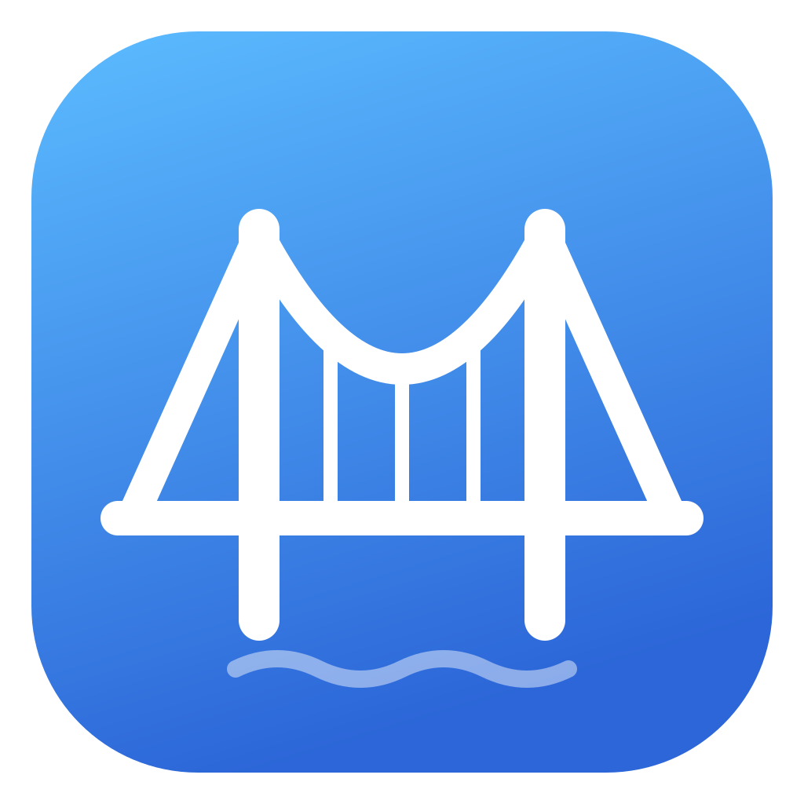
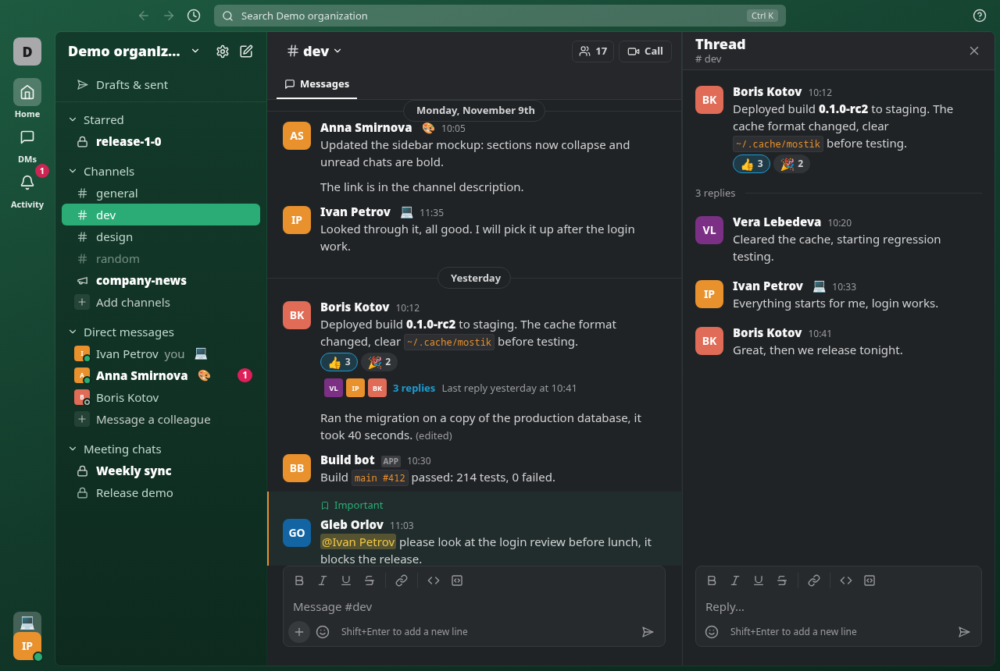
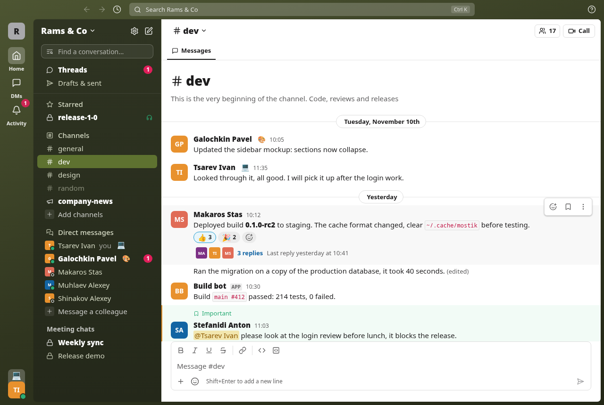
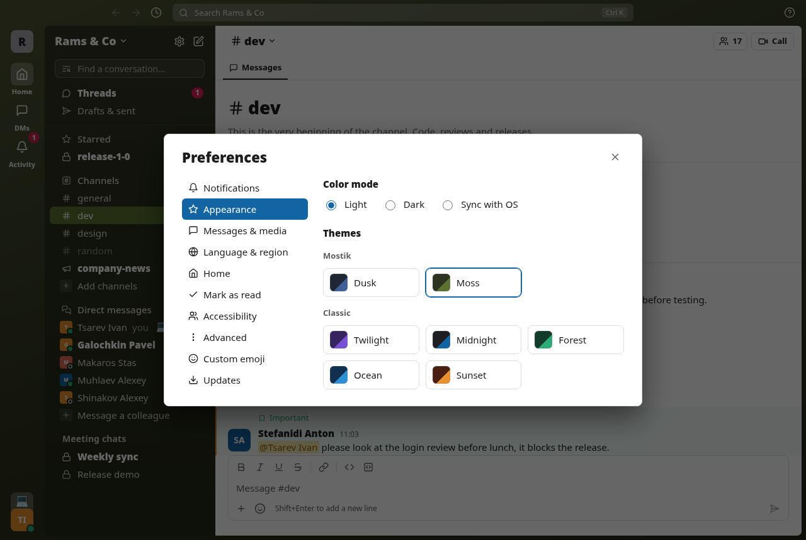

# Мостик

Неофициальный клиент чатов Яндекс Телемоста для Linux и Windows.

> [!WARNING]
> Мостик не связан с ООО «Яндекс» и не поддерживается им. Он работает через недокументированный
> протокол веб-клиента Телемоста, который может измениться в любой момент.
> «Яндекс» и «Телемост» являются товарными знаками их правообладателя.



## Возможности

- Каналы, группы, личные сообщения, треды, чаты встреч и каналы-рассылки.
- Правка, удаление, реакции, упоминания, отметка «важное», разметка и блоки кода.
- Свои emoji, как в Slack: в тексте и в реакциях, общие для всех в организации, кто пользуется Мостиком.
- Файлы и картинки: через «+» или перетаскиванием.
- Обновления в реальном времени, уведомления, значок в трее, статусы и присутствие.
- Поиск по загруженным сообщениям (Ctrl+K).
- Светлая и тёмная темы, интерфейс на русском и английском.

- Созвоны в отдельном окне, как хаддлы в Slack: текущий звонок виден внизу сайдбара.

Поиска по всей истории на сервере пока нет.

| Светлая тема | Настройки |
|---|---|
|  |  |

## Установка

Скачайте файл из [последнего релиза](https://github.com/tsarev-i/Mostik/releases/latest):

- Linux: `Mostik_*_amd64.AppImage`, перед первым запуском `chmod +x`.
- Windows: установщик `Mostik_*_x64-setup.exe`.

Новые версии Мостик находит сам: в верхней панели появляется кнопка «Обновить».
Автопроверку можно выключить в «Настройки → Обновления», там же можно проверить и обновить вручную.

## Вход и данные

Вход через Яндекс ID, в том числе корпоративный SSO, на странице Яндекса в окне приложения.
Мостик хранит только cookie сессии, и только в системном хранилище паролей. Он обращается
к серверам Яндекса, где представляется в `User-Agent` как `Mostik/<версия>`, и к релизам
на GitHub, чтобы проверить обновления.

## Звонки

В WebKitGTK, на котором Мостик работает в Linux, нет WebRTC. Поэтому там окно звонка
открывает установленный браузер на Chromium (Chromium, Chrome, Яндекс Браузер, Edge, Brave или
Vivaldi) в режиме приложения: без вкладок и адресной строки, с чистым временным профилем, в
который Мостик передаёт сессию, так что входить заново не нужно. Профиль удаляется, когда окно
закрывается. Другой браузер можно указать в переменной `MOSTIK_CALL_BROWSER`. Если такого
браузера нет, звонок откроется в браузере по умолчанию. В Windows звонок идёт во встроенном окне
WebView2. В окне только сама встреча, без мессенджера и сервисов Яндекс 360; после выхода из
встречи оно закрывается.

## Сборка из исходников

Написан на Rust (Tauri 2 и Leptos). Понадобятся Rust 1.94+, цель `wasm32-unknown-unknown`,
`wasm-bindgen-cli` той же версии, что `wasm-bindgen` в `Cargo.lock`, и `tauri-cli` 2.
На Linux ещё WebKitGTK 4.1:

```bash
sudo apt install libwebkit2gtk-4.1-dev libayatana-appindicator3-dev librsvg2-dev   # Debian/Ubuntu
rustup target add wasm32-unknown-unknown
cargo install wasm-bindgen-cli --version 0.2.130 --locked
cargo install tauri-cli --version 2.12.4 --locked
```

```bash
scripts/ui.sh serve                              # интерфейс в браузере на демо-данных: http://127.0.0.1:1420
scripts/ui.sh build && cargo run -p mostik-app   # приложение
cargo tauri build                                # AppImage на Linux, установщик на Windows
cargo test --workspace                           # тесты
```

На Windows скрипты запускаются из Git Bash. Инструменты разработчика в отладочной сборке
включаются переменной `MOSTIK_DEVTOOLS=1`.

| Путь | Что внутри |
|---|---|
| `crates/mostik-core` | Модель (чаты, сообщения, люди), разбор разметки, демо-данные |
| `crates/mostik-yandex` | Протокол веб-клиента Телемоста: HTTP RPC и WebSocket Xiva |
| `app/ui` | Интерфейс на Leptos (wasm) |
| `app/src-tauri` | Десктоп-оболочка на Tauri 2: вход, хранение сессии, уведомления, трей |
| `docs/design.md` | Размеры, цвета и поведение интерфейса |

## Лицензия

[MIT](LICENSE).

---

**In English:** Mostik is an unofficial desktop client for Yandex Telemost chats on Linux and Windows,
written in Rust with Tauri 2 and Leptos. It is not affiliated with Yandex LLC.
